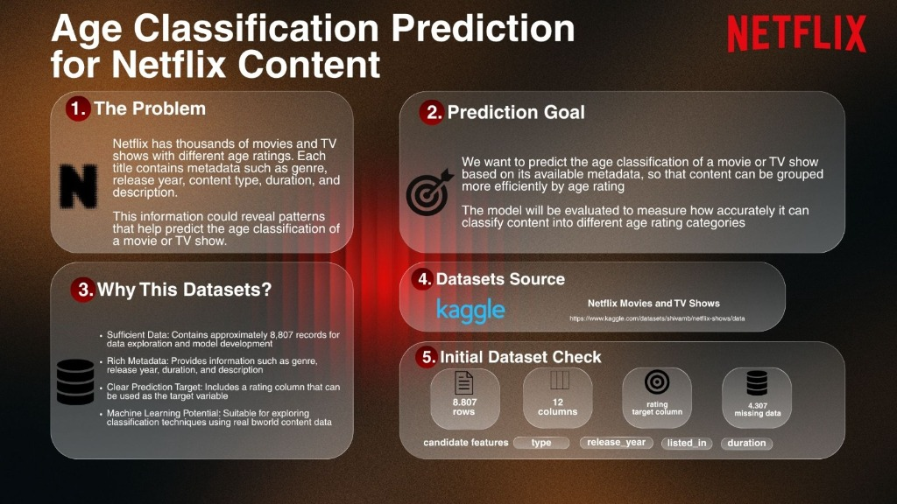

# Netflix Content Rating Prediction

Project ini bertujuan untuk memprediksi kategori klasifikasi usia penonton (rating) pada konten film dan serial TV di Netflix menggunakan pendekatan Machine Learning berbasis klasifikasi multikelas.

## 1. Deskripsi Data Mentah (Awal)

Data mentah bersumber dari dataset Kaggle (Netflix Movies and TV Shows oleh Shivam Bansal):
- Jumlah baris: 8.807 baris
- Jumlah kolom: 12 kolom
- Data duplikat: 0 baris
- Total missing values: 4.307 data kosong
  - director: 2.634
  - country: 831
  - cast: 825
  - date_added: 10
  - rating: 4
  - duration: 3

## 2. Data Cleaning dan Feature Engineering

Langkah persiapan data yang dilakukan sebelum training:
- Menghapus 4 baris data dengan target rating kosong.
- Menghapus 3 baris anomali format durasi pada kolom rating.
- Mengekstrak kolom durasi menjadi dua fitur baru: duration_value (numerik) dan duration_unit (kategorikal).
- Ukuran data bersih: 8.800 baris.
- Fitur input yang digunakan: type, release_year, duration_value, duration_unit, listed_in.
- Target variabel: rating (14 kategori rating usia).

## 3. Hasil Pembagian Data dan Training Model

Data dibagi menggunakan metode Stratified Split (80:20):
- Data Latih (Training Set): 7.040 baris (80%)
- Data Uji (Testing Set): 1.760 baris (20%)

Model dan Evaluasi:
- Algoritma: Multinomial Logistic Regression (class_weight='balanced', max_iter=1000)
- Pipeline Preprocessing: StandardScaler untuk fitur numerik dan OneHotEncoder untuk fitur kategorikal
- Akurasi Keseluruhan: 40.28%

## 4. Contributors

- Muhammad Ichsan Junaedi (NIM: 241572010024)
- Muhammad Naufal Fauzan (NIM: 241572010008)
- Fikri Prasetyono (NIM: 241572010001)
- Mutiara Adinda (NIM: 241572010005)
